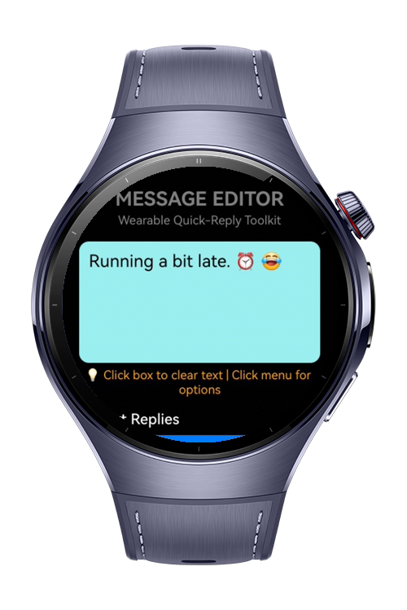
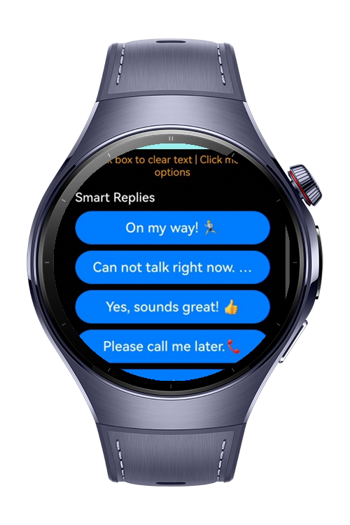
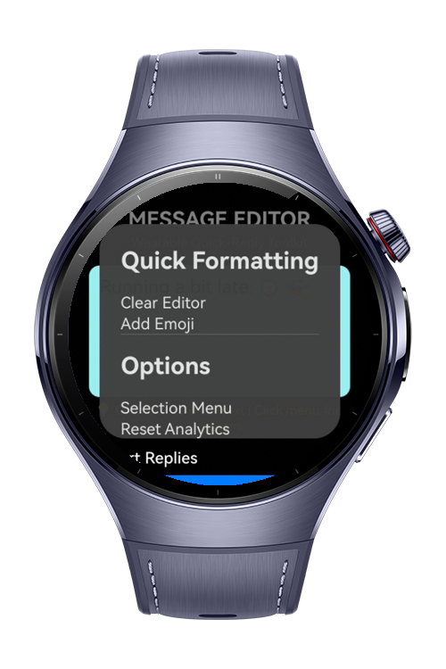
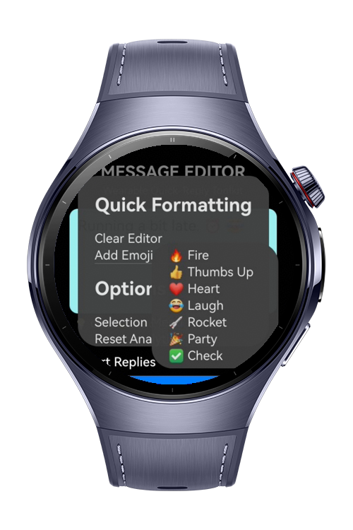

> **Note:** To access all shared projects, get information about environment setup, and view other guides, please visit [Explore-In-HMOS-Wearable Index](https://github.com/Explore-In-HMOS-Wearable/hmos-index).

# How to Build Context Menu Editor

The `how-to-build-context-menu-editor` codelab demonstrates how to build a wearable-optimized quick-reply editor with context menus in HarmonyOS.
A watch-friendly ArkUI sample for `bindMenu` context menus, text formatting utilities, smart replies, and real-time usage analytics.
The app combines MVVM architecture, nested/sub-menu builders, template message insertion, dynamic placeholder clearing, dark/light resource colors, and compact scrolling layouts tailored for round watch screens.

# Preview
<div>
  
  
  
  
</div>

# Use Cases
- **Context menu interaction**: trigger floating context menus using `.bindMenu()` on interactive UI containers.
- **Sub-menu navigation**: demonstrate nested menu structures using `@Builder` methods for emoji sub-menus and text utility groups.
- **Smart reply templates**: append pre-defined quick-reply templates to the current editor content.
- **Dynamic placeholder handling**: clear the default hint text automatically on first tap while preserving user input on subsequent taps.
- **Text transformation tools**: support uppercase, lowercase, cut, copy, and paste text actions directly from context sub-menus.
- **Usage analytics monitoring**: track character count, paste operations, clear actions, emoji usage, and last event status in real time.
- **MVVM architecture**: separate state management (`MessageEditorViewModel`) and data models (`MessageModel`) from the UI layer (`Index.ets`).
- **Resource-based UI**: externalize all hardcoded string labels (`string.json`) and color schemes (`color.json`) for localization and clean ArkTS practices.
- **Wearable layout design**: use vertical scrolling, compact margins, and watch-friendly menu item heights (`16vp`) optimized for round watch displays.

# Tech Stack
- **Languages**: ArkTS / ArkUI
- **Frameworks**: HarmonyOS SDK 6.0.1(21)
- **Tools**: DevEco Studio, Hvigor
- **Libraries**:
    - `@kit.ArkUI` (Scroll, Column, Row, Text, Button, Menu, MenuItem, MenuItemGroup)
    - `@kit.AbilityKit` (UIAbility, lifecycle)

# Directory Structure
```
entry/src/main/
|---ets/
|   |---entryability/
|   |   |---EntryAbility.ets          
|   |---entrybackupability/
|   |   |---EntryBackupAbility.ets
|   |---model/
|   |   |---MessageModel.ets         
|   |---viewmodel/
|   |   |---MessageEditorViewModel.ets
|   |---pages/
|       |---Index.ets              
|---resources/
|   |---base/
|   |   |---element/
|   |   |   |---color.json        
|   |   |   |---float.json
|   |   |   |---string.json   
|   |   |---media/
|   |   |---profile/
|   |---dark/
|       |---element/
|           |---color.json      
|---module.json5                 
```

# Constraints and Restrictions
## Supported Devices
- Huawei Watch 5

# License
How to Build Context Menu Editor is distributed under the terms of the MIT License.
See the [LICENSE](LICENSE) for more information.